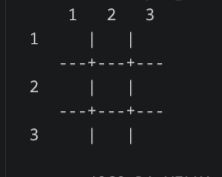

# ❌⭕ Jogo da Velha (em Python Puro)

> Uma implementação do clássico **Jogo da Velha** em Python Standard, desenvolvida sem bibliotecas externas (`import`) ou funções customizadas (`def`), com foco em lógica pura, controle de matrizes e estatísticas de sessão.




---

## 📌 Sobre o Projeto

O projeto consiste na recriação do **Jogo da Velha** para ser jogado via terminal. O objetivo é exercitar conceitos fundamentais de programação e manipulação de matrizes bidimensionais (3x3)

Além do fluxo básico da partida, o projeto conta com um **Desafio de Lógica**: um sistema dinâmico de **Estatísticas da Sessão**, que armazena o histórico do jogador, calculando métricas como porcentagem de vitórias e maior sequência de vitórias sem a necessidade de banco de dados ou bibliotecas externas.

---

## 🛠️ Restrições Técnicas & Regras de Código

Para fins acadêmicos e consolidação da lógica de programação pura, o desenvolvimento seguiu rigorosamente as seguintes limitações:

- ❌ **Sem bibliotecas externas ou nativas:** Zero uso de `import`.
- ❌ **Sem funções:** Nenhuma declaração com `def` — o fluxo é controlado inteiramente em loops e condicionais estruturados.
- ✅ **Recursos Permitidos e Utilizados:**
  - Tipos de dados primitivos (`int`, `str`, `bool`, `float`).
  - Operadores aritméticos, relacionais e lógicos.
  - Estruturas de decisão (`if`, `elif`, `else`).
  - Estruturas de repetição (`while`, `for`).
  - **Matriz 3x3 com `for` Aninhado:** Para representação, navegação e renderização do tabuleiro com linhas e colunas visíveis.

---

## 👥 Divisão de Trabalho & Responsabilidades

O desenvolvimento do projeto foi distribuído entre três colaboradoras da seguinte forma:

| Colaboradora | Papel / Responsabilidade | Tarefas Específicas |
| :--- | :--- | :--- |
| **Marina Alencar** | **Estrutura, Menu e Reinício** | • Menu principal interativo controlado por `while` (opções: jogar, ver regras, ver placar, sair).<br>• Exibição da matriz do tabuleiro a cada jogada usando `for` aninhado, garantindo que os números das linhas e colunas fiquem visíveis.<br>• Lógica de reiniciar a partida limpando o tabuleiro para a próxima rodada sem fechar o programa. |
| **Marina Sousa** | **Validação de Entradas e Turnos** | • Leitura das jogadas com validação rigorosa para evitar que letras, símbolos, espaços em branco ou números fora do intervalo quebrem o código.<br>• Checagem de ocupação da casa escolhida (alerta e solicita nova jogada se a casa estiver ocupada).<br>• Alternância contínua de turnos entre o Jogador 1 ('X') e Jogador 2 ('O'). |
| **Sílvia** | **Verificação de Vitória/Empate, Placar e Desafio** | • Verificação automática de vitória e empate percorrendo o tabuleiro com laços `for` (linhas, colunas e diagonais).<br>• Placar acumulado entre as partidas (vitórias de cada jogador e empates).<br>• **Desafio de Lógica (Estatísticas de Sessão):** Cálculo de estatísticas detalhadas (total de partidas, vitórias, empates, porcentagem e maior sequência) exibidas ao selecionar "Sair". |

---

## 🧠 Arquitetura e Fluxo do Código
```text
┌─────────────────────────────────────────────────────────────┐
│                    MENU PRINCIPAL (while)                   │
│                     (Marina Alencar)                        │
│                                                             │
│ 1. INICIAR TABULEIRO 3 x 3 & DESENHAR COM FOR ANINHADO      │
│    Exibe e limpa o tabuleiro a cada nova rodada.            │
│                                                             │
│ 2. LEITURA & VALIDAÇÃO DA JOGADA                            │
│    (Marina Sousa)                                           │
│    Garante entrada válida, verifica casa livre e alterna    │
│    os turnos ('X' / 'O').                                   │
│                                                             │
│ 3. PROCESSAMENTO DE VITÓRIA / EMPATE                        │
│    (Sílvia)                                                 │
│    Varre a matriz via `for`, atualiza placar e acumula      │
│    métricas da sessão.                                      │
│                                                             │
│ 4. OPÇÃO DE SAIR                                            │
│    Exibe a tela de Estatísticas de Sessão completas.        │
└─────────────────────────────────────────────────────────────┘

## 🚀 Como executar o projeto

### 📋 Pré-requisitos

- **Python 3.8** ou superior instalado em sua máquina.
  - Para verificar se já possui o Python instalado, abra o terminal/prompt de comando e digite:
    ```bash
    python --version
    ```
    *(Caso precise instalar, faça o download no site oficial: [python.org](https://www.python.org/))*

---

### 🛠️ Passo a Passo para Execução

1. **Clone o repositório:**
   git clone [https://github.com/Marina-Sousa/jogo-da-velha-python.git](https://github.com/Marina-Sousa/jogo-da-velha-python.git)

  2. Acesse a pasta do projeto:
  cd jogo-da-velha-python

  3. Execute o script principal:
  No Windows:
  python main.py
  
  4. No Linux / macOS:
  python3 main.py

